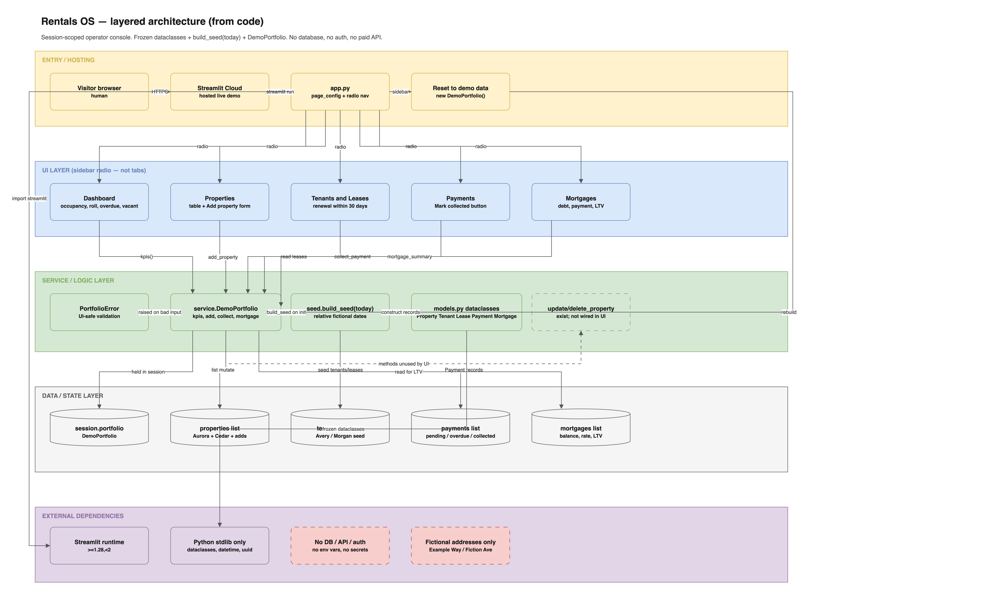

# Rentals OS — SASK SW Services Demo

A session-isolated Streamlit portfolio demo built by **SASK SW Services**
(SASK LLC, Saratoga, CA). It shows the dashboard we build for rental-property
operators: portfolio KPIs, properties, tenants and leases, rent payments, and
mortgage summaries in one place.

Every record is conspicuously fictional. The app uses no database, external
service, analytics, authentication, or paid API — state lives in the session
and resets on demand.

## Features

- Live occupancy, rent-roll, collection, and vacancy KPIs
- Property creation with metrics updating immediately
- Lease-renewal flags, payment collection, and mortgage LTV views
- One-click reset to deterministic fictional seed data

## Run locally

```bash
pip install -r requirements.txt
streamlit run app.py
```

## Deploy

This folder is published in the SASK public showcase repository
(github.com/saskllc-blip/public). On Streamlit Community Cloud, create an app
from that repository, branch `main`, with main file path
`sask-rentals-demo/app.py`. No secrets are required.

## Architecture



See [docs/architecture.md](docs/architecture.md).

---
© 2026 SASK LLC — SW Services · Public portfolio demonstration.
AI tools for speed, human review and automated testing for reliability.
