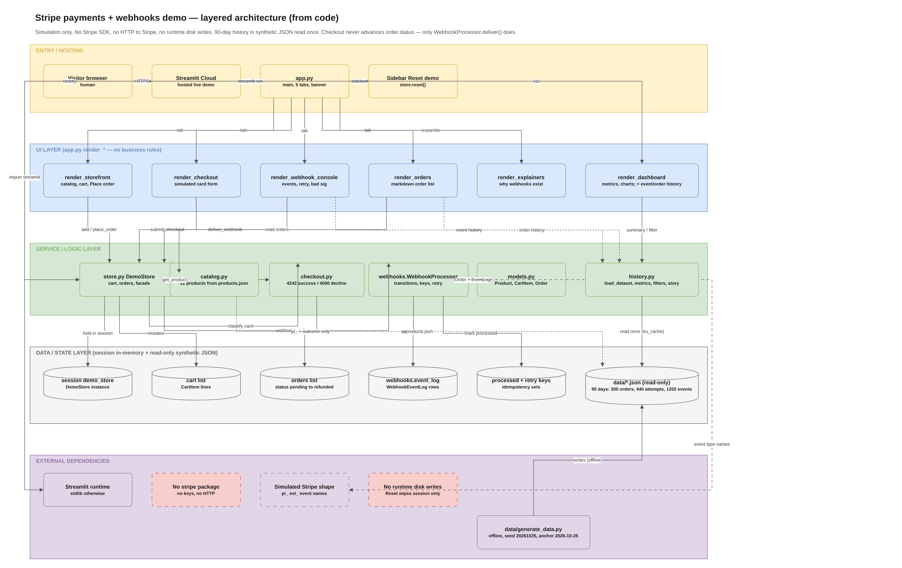

# SASK LLC — Stripe payments + webhooks demo store

Self-contained Streamlit portfolio demo branded **SASK LLC — SW Services**.
It makes API-integration work *visible*: a fictional mini-store, a simulated
Stripe-shaped checkout, and a webhook event console that teaches signature
verification, retries, and idempotency.

**Suggested public repo name:** `sask-stripe-demo`

> Demo store — simulated payments only. No real charges, no real payment data.
> Zero secrets ship with this app. Simulation-only is the default and the
> public demo mode.

## What you can show a buyer

1. **Storefront** — twelve fictional products (loaded from `data/products.json`), a cart, and order records with
   visible status (`pending` → `paid` → `fulfilled` / `failed` / `refunded`).
2. **Simulated checkout** — card form accepts `4242 4242 4242 4242` (success)
   and `4000 0000 0000 0002` (decline), labeled *simulated — no real charge*.
   The Pay button does **not** mark the order paid; only webhooks do.
3. **Webhook console** — deliver `payment_intent.succeeded`,
   `payment_intent.payment_failed`, and `charge.refunded`. Event log shows
   timestamp, type, signature status, and processing result.
4. **Idempotency** — re-deliver the same event →
   `duplicate — ignored, idempotency key …`.
5. **Retry** — toggle “Fail processing”, deliver once (queued for retry),
   turn the toggle off, deliver again → processed.
6. **Explainers** — short plain-English copy on why webhooks, signatures, and
   idempotency matter.
7. **90-day payment history (synthetic)** — a *Dashboard (90 days)* tab with
   gross / refunds / disputes / net volume and daily charts, plus searchable
   order history (Orders tab) and webhook event history (Webhook console tab)
   over ~300 orders, ~440 payment attempts, and ~1,200 Stripe-shaped events.
   Every number is computed from the dataset; nothing is hardcoded.

## Synthetic data

All history lives in `data/*.json`, written by `data/generate_data.py`
(fixed seed `20261025`, fixed anchor `2026-10-25T23:59:59Z`, 90-day window).
Customers are invented names on `example.com` / `example.org`; products are
fictional; card details are Stripe test-card shapes. Regenerate (byte-identical):

```bash
python3 data/generate_data.py
```

## Run locally (standalone)

From **this folder** (no monorepo package path required):

```bash
cd products/sask_stripe_demo
python3 -m venv .venv
source .venv/bin/activate   # Windows: .venv\Scripts\activate
pip install -r requirements.txt
streamlit run app.py
```

Open the URL Streamlit prints (usually `http://localhost:8501`).

From the `KK_AI_PLATFORM` repo root (optional):

```bash
streamlit run products/sask_stripe_demo/app.py
```

## Tests

From this folder (needs `pip install -r requirements.txt pytest`):

```bash
python3 -m pytest tests -q
```

Covers generator determinism, dataset size bands, referential integrity,
per-order lifecycle/timestamp ordering, money reconciliation, and a headless
Streamlit AppTest of every tab.

## Streamlit Community Cloud (free tier)

1. Publish a public repo (suggested name `sask-stripe-demo`) with this folder
   as the app root, **or** point Cloud at `products/sask_stripe_demo/app.py`
   inside a monorepo.
2. Set the main file to `app.py` (standalone layout) or
   `products/sask_stripe_demo/app.py` (monorepo layout).
3. Use `requirements.txt` from this folder. Do **not** add Stripe secret keys.
4. Deploy. No secrets, env vars, or paid add-ons are required.

## Optional real Stripe TEST-mode (off by default — not used by the public demo)

This repository ships **simulation-only**. If TEST-mode Stripe is ever added:

- Gate it behind an explicit env flag such as `SASK_STRIPE_MODE=test`
  (default unset / `sim` = simulation).
- Accept **test keys only** (`pk_test_…` / `sk_test_…` / `whsec_…` test
  secrets). Never commit keys; never enable live keys in this demo.
- Document the flag here before enabling it. The public Cloud deploy must
  remain simulation-only.

## Screenshots

Capture plan and storage path:

- `docs/products/sask_stripe_demo/ssd001-screenshot-plan.md`
- Images: `docs/products/sask_stripe_demo/screenshots/`

Expected frames: storefront, checkout, webhook console (processed event),
idempotency duplicate, refunded order.

## Architecture



See [docs/architecture.md](docs/architecture.md). Draw IO source:
[docs/architecture.drawio](docs/architecture.drawio) — includes the read-only
synthetic data layer (`data/*.json` → `history.py` → Dashboard / history views)
and the offline generator.

---

© 2026 SASK LLC — SW Services · Portfolio demonstration · free tiers only.
